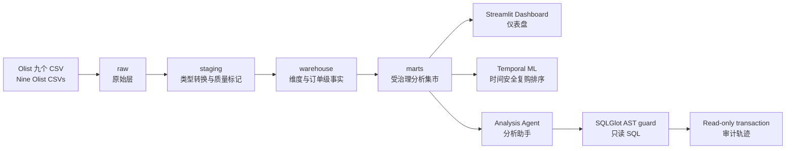

# 架构 / Architecture

## 数据流 / Data flow

**中文。** 数据从九个 Olist CSV 进入 `raw`；`staging` 完成类型转换、文本标准化与异常标记；`warehouse` 构建客户、商品、卖家、日期维度及订单、订单商品、支付、评价事实；`marts` 提供仪表盘、建模和 Agent 的受治理消费边界。所有下游解释必须尊重其行粒度。

**English.** Data enters `raw` from nine Olist CSVs; `staging` performs type conversion, text normalization, and anomaly flags; `warehouse` builds customer, product, seller, and date dimensions plus order, order-item, payment, and review facts; `marts` are governed consumption boundaries for the dashboard, modeling, and the Agent. Every downstream interpretation must respect row grain.

## 金额与客户身份 / Money and customer identity

**中文。** 一个订单可能有多条商品行和多笔支付。架构先把商品金额/运费和支付金额各自在订单级预聚合，再写入 `warehouse.fact_orders`，从源头避免商品 × 支付连接的金额翻倍。指标要在商品金额、运费和支付金额之间明确选择口径。客户维度以 `customer_unique_id` 生成 `customer_key`；不能把同一真实客户的多个地址层 `customer_id` 当成多个客户。

**English.** One order can have multiple item rows and multiple payments. The architecture preaggregates item revenue/freight and payment value separately at order grain before writing `warehouse.fact_orders`, preventing item × payment join inflation at the source. A metric must explicitly choose among item revenue, freight, and payment value. The customer dimension generates `customer_key` from `customer_unique_id`; multiple address-level `customer_id` values for the same person must not be treated as multiple customers.

## 时间安全的标签 / Observation-window-safe labels

**中文。** 分析集市和 ML 有意保留两套不同用途的时间锚点。`customer_360` 以及复用其标签的商品/履约集市，以首购 `purchased_at` 为起点，并用 delivered 订单的数据终点 `MAX(purchased_at)` 判断 90 天观察完整性；这些 purchase-anchored 标签用于描述性业务指标。

**English.** The analysis marts and ML intentionally retain two time anchors for different purposes. `customer_360`, plus the product and delivery marts that reuse its label, starts at first-purchase `purchased_at` and uses the delivered-order data-end `MAX(purchased_at)` to determine whether the 90-day window is complete. These purchase-anchored labels support descriptive business metrics.

**中文。** 建模集市在首笔已送达订单的送达时间设定 `prediction_time` 和 `feature_available_at`。标签选择后续已送达订单，但窗口比较的是后续已送达订单的 `purchased_at` 是否在 `(prediction_time, prediction_time + 90 天]`，并要求数据观察终点已覆盖该窗口；它不以该后续订单的送达时间比较。否则 `eligible_for_90d = false`、标签为 NULL。时间切分为训练、选择、校准和最终测试，最终测试不参与选择。这样不使用未来订单、评论、最终 RFM 或最终累计消费等在预测时不可见的信息。

**English.** The modeling mart sets `prediction_time` and `feature_available_at` at the delivery time of the first delivered order. The label selects a later delivered order, but compares that later delivered order's `purchased_at` with `(prediction_time, prediction_time + 90 days]` and requires the data observation end to cover that window; it does not compare that later order's delivery time. Otherwise `eligible_for_90d = false` and the label is NULL. Time is split into training, selection, calibration, and final test, and final test does not participate in selection. This avoids future orders, reviews, final RFM, or final cumulative spend that would be unavailable at prediction time.

## Agent 安全边界 / Agent safety boundary

**中文。** Agent 的 `run_safe_sql` 首先以 SQLGlot AST 校验单条 SELECT：拒绝 DDL、DML、事务、命令、未治理来源、非分析函数和不合法 LIMIT；只允许白名单 `marts` 对象，缺省上限为 500、最大为 2,000。通过后，执行器建立只读 SQL 事务、设置五秒语句超时，最多序列化 2,000 行。工具调用生成包含状态、耗时和摘要的审计轨迹；敏感键脱敏，过长字符串截断。指标定义、图表、复购评分和 ROI 模拟也由固定 schema 和输入上限约束。

**English.** The Agent's `run_safe_sql` first uses a SQLGlot AST to validate one SELECT: it rejects DDL, DML, transactions, commands, non-governed sources, non-analytical functions, and invalid LIMIT values; it accepts only allowlisted `marts` objects, with a default limit of 500 and a maximum of 2,000. After validation, the executor opens a read-only SQL transaction, sets a five-second statement timeout, and serializes at most 2,000 rows. Tool calls generate audit traces with status, duration, and a summary; sensitive keys are redacted and long strings truncated. Metric definitions, charts, repurchase scoring, and ROI simulation are also bounded by fixed schemas and input limits.

## 运行模式 / Operating modes

**中文。** Docker Compose 仅运行 PostgreSQL；Streamlit 由本地 Python 3.13 启动。`verify_project.py` 的默认检查观察容器、模式、集市、产物和 Git 状态，不下载数据、不重建表、不训练模型、不启动 Streamlit、也不调用 LLM。完整模式只在健康检查后运行显式列出的非 SQL 测试目录和 Ruff，排除会重建当前数据库的 `tests/sql`。恢复模式才依序 bootstrap、加载 raw、构建 warehouse/marts、运行 `py -3.13 scripts/run_quality_checks.py`、训练模型并执行 fake Agent 评估。质量报告入口读取现有数据库，并且只写入 `artifacts/quality/latest.json`，不重建数据层。

**English.** Docker Compose runs PostgreSQL only; Streamlit starts through local Python 3.13. The default `verify_project.py` check observes containers, schemas, marts, artifacts, and Git state; it does not download data, rebuild tables, train a model, start Streamlit, or call an LLM. Full mode runs only explicitly listed non-SQL test directories and Ruff after health checks, excluding `tests/sql`, which rebuilds the current database. Only restore mode runs bootstrap, raw loading, warehouse/mart building, `py -3.13 scripts/run_quality_checks.py`, model training, and fake Agent evaluation in sequence. The quality-report entrypoint reads the existing database and writes only `artifacts/quality/latest.json`; it does not rebuild a data layer.
